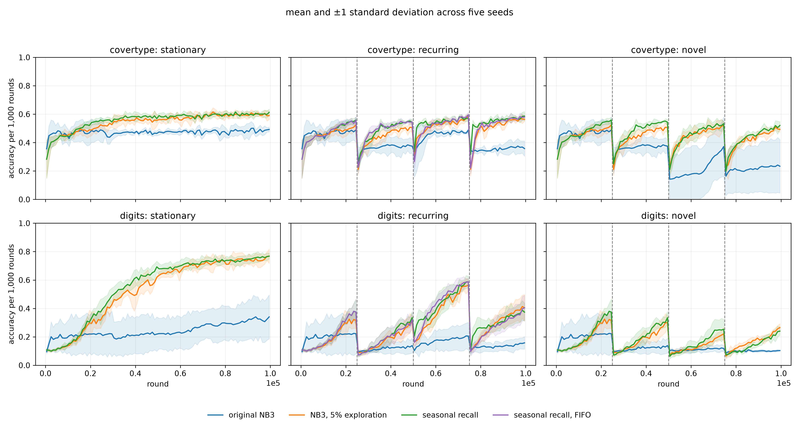
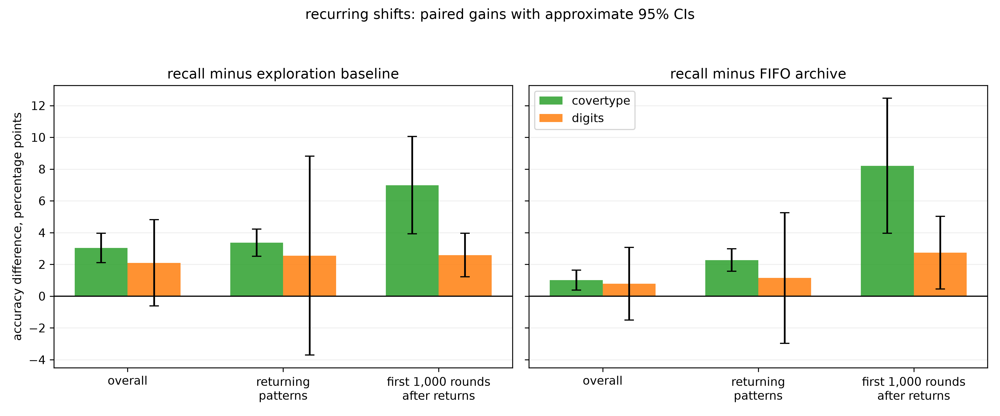

# Seasonal Recall: Memory-Augmented NeuralBandit

This project reproduces NeuralBandit2 and NeuralBandit3 from [A Neural Networks Committee for the Contextual Bandit Problem](https://arxiv.org/abs/1409.8191) and evaluates an extension called Seasonal Recall.

Seasonal Recall investigates whether saved neural models can improve online prediction when previously encountered reward patterns return.

**Research question: Can reusing past models improve prediction and adaptation when familiar reward patterns return?**

## Project overview

The project has two parts:

1. Reproduce the original experimental methodology on Covertype.
2. Evaluate Seasonal Recall on Covertype and Digits under stationary, recurring, and previously unseen reward patterns.

Seasonal Recall maintains a current NeuralBandit3 model that continues learning and a small archive of frozen models. It combines their action recommendations and uses importance-weighted feedback to update the model-selection weights.

Early experiments explored change detection and model restoration. The final method uses periodic archiving and shared-feedback routing.

## Setup

The experiments used Python 3.14.7 on a Mac laptop with CPU execution. The tested package versions are recorded in `requirements.txt`.

From the project folder:

```bash
python3 -m venv .venv
source .venv/bin/activate
python -m pip install -r requirements.txt
python -m pip check
```

Check the dataset loaders and final model:

```bash
python load_dataset.py
python load_digits_dataset.py
python check_shared.py
```

Covertype downloads through scikit-learn on first use. Digits is included with scikit-learn.

## Datasets and feedback

### Covertype

Covertype contains 581,012 examples and seven classes.

Each of the ten numerical features is converted into five quantile-bin indicators. Combined with the 44 existing binary features, each example has 94 input features.

The seven classes correspond to actions 1–7.

### Digits

Digits contains 1,797 examples, 64 pixel features, and ten classes.

Pixel values are divided by 16 to scale them to [0, 1]. Labels are shifted from 0–9 to actions 1–10 to keep action numbering consistent across the code.

Digits provides a second dataset for evaluating the extension.

### Bandit feedback

At each round, the model receives an example and chooses a class.

- A correct prediction receives a reward of 1.
- An incorrect prediction receives a reward of 0.

The learner receives feedback only about its chosen action. The correct class is used by the environment to calculate the reward.

The experiments measure online accuracy while the model learns from the stream. The stream cycles through the dataset, repeatedly presenting examples. The results describe performance on this stream and do not estimate accuracy on a separate held-out dataset.

## Reproducing the original method

The reproduction includes:

- NeuralBandit2
- NeuralBandit3
- LinUCB
- Linear contextual Thompson sampling, labeled CTS
- Banditron

The neural models combine five hidden-layer sizes, `[1, 5, 25, 50, 100]`, with three learning rates, `[0.01, 0.1, 1.0]`. This gives 15 configurations.

The reproduction settings are:

- **Input features:** 94
- **Actions:** 7
- **Action exploration:** 0.005
- **Model exploration:** 0.1
- **Dataset shuffle seed:** 67
- **Run seeds:** 67–76
- **Rounds per run:** 2,500,000
- **Nonstationary shift interval:** 500,000 rounds

The dataset is shuffled once, and each run starts at a random position. The stream loops through the shuffled dataset as needed.

For the nonstationary setting, class labels rotate every 500,000 rounds: class 1 becomes class 2, class 2 becomes class 3, and class 7 becomes class 1.

Run the experiments:

```bash
python run_experiment.py
```

The script reuses completed result files. It can also reuse the first 2.5 million rewards from earlier six-million-round stationary runs if those files are available locally.

Generate the reproduction accuracy figures:

```bash
python plot_results.py
```

Train the offline reference and generate the reference comparison:

```bash
python train_reference.py
python plot_reference_regret.py
```

### Reproduction details

The implementation follows the paper's experimental methodology. The numerical results and algorithm ranking differ from those reported in the paper.

The 2.5-million-round horizon was selected from the plotted extent of Figure 1. The experimental text does not explicitly state the horizon.

In the implemented NeuralBandit3, each action's sampled configuration selector is updated using the observed global reward. This is the interpretation used throughout the project.

The offline reference is a supervised MLP trained and evaluated on the full Covertype dataset. It achieves approximately 83.46% fitted-data accuracy. The paper reports a reference accuracy of 93%.

The reference plots measure cumulative reward differences from this fitted MLP. They depend on the reference model's performance and do not establish regret against an optimal policy. For the nonstationary comparison, the reference is effectively given knowledge of the label rotation.

## How Seasonal Recall works

Seasonal Recall keeps past models available as reward patterns change.

The method maintains:

- A current NeuralBandit3 model that continues training.
- An archive of up to three frozen models.
- Selection weights that determine how the models' recommendations are combined.

At each round:

1. The current and saved models produce action probabilities.
2. The router combines those probabilities.
3. An action is sampled and its reward is observed.
4. The current model's reward networks are trained using the actual probability of the chosen action.
5. Importance-weighted reward estimates update the model-selection weights.

The saved models remain frozen.

### Saving and comparing models

A model is saved every 7,000 rounds.

The diverse archive compares models using their decisions on the same 128 past contexts. Similar models can replace one another, and the archive stores at most three saved policies.

A FIFO archive removes the oldest policy when the archive is full. This provides an ablation for the archive mechanism.

The final settings are:

- **Action exploration:** 0.05
- **Internal model exploration:** 0.1
- **Router exploration:** 0.1
- **Router discount:** 0.999
- **Maximum saved policies:** 3
- **Archive interval:** 7,000 rounds
- **Reference contexts:** 128
- **Minimum signature disagreement:** 0.1

The router uses a fixed random seed of zero. The main random generator and network initialization use the run seed.

## Extension experiments

Three methods are compared in each environment:

- **Original NB3:** action exploration of 0.005 with no policy archive.
- **Exploration baseline:** action exploration of 0.05 with no policy archive.
- **Seasonal Recall:** action exploration of 0.05 with a diverse policy archive.

The exploration baseline measures the effect of increasing exploration. Comparing Seasonal Recall with this baseline measures the additional benefit of the extension.

The FIFO archive is evaluated as an additional ablation on recurring patterns.

### Environments

Each run contains 100,000 rounds divided into four segments of 25,000 rounds.

- **Stationary:** A → A → A → A
- **Recurring:** A → B → A → B
- **Novel shifts:** A → B → C → D

The patterns are constructed using circular label shifts. These controlled synthetic changes specify when a pattern changes and returns.

The learner receives contexts and observed rewards. Pattern identities and switch times remain within the environment.

The experiments use run seeds 90–94 and a dataset shuffle seed of 67. For a matching seed, all methods receive the same context sequence and starting position.

The complete evaluation contains 90 main runs and ten FIFO-ablation runs.

### Running the experiments

For six short pilot runs, set this near the top of `run_final.py`:

```python
pilot = True
```

For the complete evaluation, use:

```python
pilot = False
```

Then run:

```bash
python run_final.py
```

On macOS, this command prevents idle sleep and saves progress:

```bash
caffeinate -i python -u run_final.py > final_experiments.log 2>&1
```

View progress from another terminal:

```bash
tail -n +1 -f final_experiments.log
```

The script checks existing results and skips matching completed files. Update the experiment version when algorithm settings change so that older results are kept separate.

### Summaries and figures

```bash
python summarize_final.py
python summarize_runtime.py
python plot_final.py
```

These commands read saved results. Model training is handled by the experiment runners.

## Results

The following values are mean online accuracy across five seeds.

### Covertype

- **Stationary:** original NB3 47.21%, exploration baseline 54.46%, Seasonal Recall 55.75%.
- **Recurring:** original NB3 40.86%, exploration baseline 47.80%, Seasonal Recall 50.84%.
- **Novel shifts:** original NB3 31.50%, exploration baseline 43.91%, Seasonal Recall 45.88%.

### Digits

- **Stationary:** original NB3 24.16%, exploration baseline 52.93%, Seasonal Recall 55.55%.
- **Recurring:** original NB3 15.59%, exploration baseline 26.04%, Seasonal Recall 28.14%.
- **Novel shifts:** original NB3 13.19%, exploration baseline 16.71%, Seasonal Recall 17.47%.

### Main findings

Increasing exploration accounted for a substantial part of the improvement over original NB3.

Seasonal Recall provided an additional improvement on recurring Covertype streams. Compared with the exploration-matched baseline, it improved:

- Overall accuracy by 3.03 percentage points.
- Accuracy during returning patterns by 3.37 percentage points.
- Accuracy during the first 1,000 rounds after returns by 6.99 percentage points.

Each difference was positive across all five seeds. The approximate paired 95% confidence intervals excluded zero.

Digits showed a consistent early-return improvement of 2.59 percentage points across all five seeds. The overall and returning-pattern improvements had confidence intervals that included zero.

The diverse archive improved recurring Covertype overall accuracy by 1.01 percentage points over FIFO.

### Measurements and uncertainty

The evaluation measures:

- **Overall accuracy:** average reward across all 100,000 rounds.
- **Returning-pattern accuracy:** average reward across the final 50,000 rounds.
- **Early-return accuracy:** average reward during the first 1,000 rounds after each return, starting at rounds 50,001 and 75,001.

Learning-curve shading shows one sample standard deviation across seeds.

Comparison intervals use paired differences across matching seeds and approximate 95% Student t confidence intervals. These intervals are based on five seeds and are unadjusted for multiple comparisons.

### Runtime

For recurring Covertype streams:

- Exploration baseline: 89.9 seconds.
- Seasonal Recall: 135.8 seconds.
- Runtime overhead: 51.1%.

For recurring Digits streams:

- Exploration baseline: 89.1 seconds.
- Seasonal Recall: 151.8 seconds.
- Runtime overhead: 70.3%.

These timings cover the online learning loop, including archiving and progress output. Dataset loading, model construction, and result-file compression are excluded.

The measurements describe performance on the laptop used for the experiments. Seasonal Recall's accuracy improvements come with additional computation and policy storage.

## Figures





PDF versions are available in the same folder.

Earlier development figures are stored in `figures/legacy/`. The figures above show the final evaluation.

## Saved results

Raw experiment files are excluded from Git. They can be regenerated using the experiment runners.

If using the prepared result archives, extract them from the project root:

```bash
unzip final_results_v1.zip
unzip reproduction_results_v1.zip
```

The archives contain:

- **`final_results_v1.zip`:** 100 files inside `final_results/`.
- **`reproduction_results_v1.zip`:** 100 reproduction files, `reference_predictions.npz`, and `reference_model.pt`.

The reproduction archive extracts its files into the project root. After extraction, the summary and plotting scripts can use the saved results directly.

## Main files

### Data loading

- `load_dataset.py`: loads and encodes Covertype.
- `load_digits_dataset.py`: loads and scales Digits.

### Original-method reproduction

- `neural_bandit.py`: implements the original neural bandit methods.
- `baselines.py`: implements LinUCB, CTS, and Banditron.
- `run_experiment.py`: runs the reproduction experiments.
- `train_reference.py`: trains the offline reference MLP.
- `plot_results.py`: generates reproduction accuracy plots.
- `plot_reference_regret.py`: plots reward differences from the reference.

### Seasonal Recall

- `neural_bandit_general.py`: implements NB3 with configurable input and action counts.
- `seasonal_recall_shared.py`: implements the final Seasonal Recall method.
- `check_shared.py`: checks actions, probabilities, and memory storage.
- `run_final.py`: runs the extension experiments.

### Analysis

- `summarize_final.py`: calculates accuracy summaries and paired comparisons.
- `summarize_runtime.py`: summarizes runtime.
- `plot_final.py`: generates the final figures.

The committed CSV files contain individual-run measurements, aggregate summaries, paired comparisons, and runtime results.

## Limitations and next steps

The results support the extension on recurring Covertype streams. The evaluation has several limitations:

- The extension experiments cover two datasets and five final seeds.
- The reward shifts are synthetic and abrupt.
- Digits repeatedly presents a small collection of examples.
- The extension experiments use a shorter horizon than the reproduction.
- Higher exploration explains a substantial portion of improvement over original NB3.
- Memory, routing, and feedback change together, so their individual contributions require further ablations.
- LinUCB, CTS, and Banditron were evaluated for reproduction. Evaluating them on the extension benchmark remains future work.
- Overall improvements on Digits are less conclusive.
- Saved models require additional computation and storage.

The contribution is an implemented and evaluated extension to NeuralBandit3. The experiments provide empirical evidence for the tested settings. A new regret guarantee and novelty of policy memory itself are outside the claims of this project.

Future work could evaluate naturally recurring reward patterns, longer streams, additional baselines, and separate ablations for routing and shared feedback.